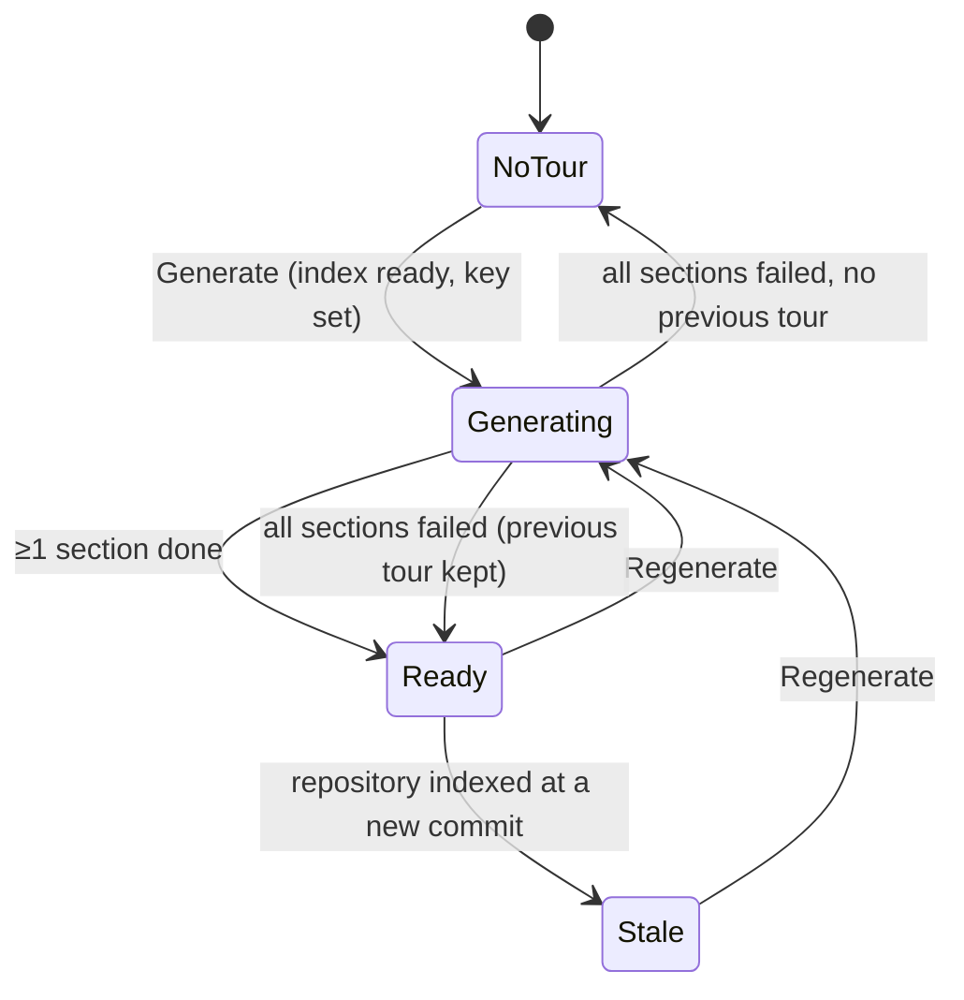

# Spec — Onboarding Generator (Onboarding Tour)
Status: draft
Changes: api/specs/http-api.md (new repo-scoped tour routes), api/specs/repos-jobs.md (a new background job kind), specs/review-flow.md (the "no step needs an LLM key except running a review" invariant, and a new step), client/docs/route-map.md and a new client screen spec for the tour page; e2e coverage of the tour page (a new flow)

## Problem & Motivation
A developer who opens an unfamiliar repository in DevDigest today sees only its pull requests.
Nothing tells them how the code is laid out, which files matter most, how to start it locally,
what to read first, or where they could make a first useful change. They have to rebuild that
picture by hand from the README and the tree.

DevDigest already holds most of the raw material: a local clone of every imported repository,
and (for TypeScript/JavaScript) a code index with a ranked repository map, per-file importance
ranks and the HTTP routes and cron schedules each file names. The Onboarding Generator turns that
material into a **tour** of the repository in five fixed sections — Architecture overview,
Critical paths, How to run locally, Guided reading path, First tasks — written once by a model,
checked against the real file tree, stored, and shown on a per-repository "Onboarding Tour" page.

Groundwork exists but is unused: an `onboarding` feature-model entry ("Onboarding Tour", default
OpenRouter `deepseek/deepseek-v4-flash") in Settings → Feature Models, a per-repository stored-tour
table, and a generic `Onboarding` contract (sections of kind/title/Markdown body/Mermaid
diagram/links). This spec does not depend on that contract's current shape; where it differs, this
spec's behavior wins and the contract changes with the API.

## Goals / Non-goals
**Goals**
- Generate, on the user's request, a tour of one imported repository with exactly five sections,
  in this order: Architecture overview, Critical paths, How to run locally, Guided reading path,
  First tasks.
- Ground every file or directory path the tour cites in the repository's actual file tree at the
  commit the tour was generated for; drop or mark anything that doesn't exist.
- Store one tour per repository, with the commit it describes, when it was generated, the model
  that wrote it and what it cost; show it until it is regenerated.
- Show clearly when the stored tour is stale (the repository has moved to another commit since).
- Let the user regenerate the tour; never run two generations of one repository at once.
- Show generation progress per section, and a tour whose sections partly failed.
- Treat everything read from the repository and everything the model writes as untrusted data.
  Commands in "How to run locally" are only displayed and copied, never executed by DevDigest.
- Show the generation's cost when the provider reports it, in the run-cost format.
- Base First tasks on the code index, the file tree and the TODO/FIXME comments in the code,
  each task sized small or medium and citing verified paths like every other section.

**Non-goals**
- Executing, validating or dry-running any command the tour suggests.
- A file viewer inside DevDigest. "Open" opens the file on GitHub at the tour's commit (AC-30).
- Generating tours automatically (after clone, refresh or resync). Generation is always a user
  action, because it costs money.
- Regenerating a single section on its own. [NEEDS CLARIFICATION: Q6]
- Editing the tour by hand, or keeping a history of earlier tours (only the latest is kept).
- Extending the code indexer to new languages. The tour works with whatever the index holds.
- "Project Context" and the other sidebar items shown in the mockups (Conventions, Eval
  Dashboard, Memory, …). Only "Onboarding Tour" is in scope.
- Creating issues, branches or tickets from First tasks, and reading GitHub issues (e.g. "good
  first issue") to find them.
- A cost estimate before generating (consistent with `specs/run-cost.md`: only billed cost).
- Share link. The page has no Share link button and no export (AC-42).

## User stories
- **US-1** As a newcomer to a repository, I open "Onboarding Tour" from the sidebar and, if no
  tour exists yet, I'm offered a button to generate one; I can jump between and collapse the
  five sections. → AC-1, AC-2, AC-3, AC-4, AC-38, AC-42
- **US-2** As a newcomer, I start generation and watch each of the five sections go from pending
  to running to done or failed, without leaving the page, and I can leave and come back.
  → AC-5, AC-6, AC-7, AC-8, AC-9, AC-10, AC-11, AC-39
- **US-3** As a newcomer, I read an Architecture overview: a short prose summary with the key
  files and directories as code chips, and a box diagram of the main components. → AC-20, AC-21,
  AC-22, AC-23
- **US-4** As a newcomer, I see the Critical paths (file + why it matters) and open any of them.
  → AC-24, AC-30
- **US-5** As a newcomer, I see numbered shell commands to run the project locally and copy each
  one; DevDigest never runs them. → AC-25, AC-26, AC-27
- **US-6** As a newcomer, I follow a numbered Guided reading path of files, each with a reason.
  → AC-28, AC-30
- **US-7** As a newcomer, I see a short list of First tasks, each sized small or medium and
  grounded in real files and TODO/FIXME comments, that I could pick up. → AC-29, AC-30, AC-40,
  AC-41
- **US-8** As a user, I can trust that every path the tour shows exists in the repository; ones the
  model invented are removed and I'm told how many. → AC-15, AC-16, AC-17, AC-18, AC-19
- **US-9** As a user, I see which commit and index the tour describes, when it was generated, and
  I'm told when it's stale so I can regenerate it. → AC-12, AC-13, AC-14, AC-31
- **US-10** As a user paying for model calls, I see what a generation cost, I can't start two at
  once by double-clicking, and generation is refused up front when no key is configured.
  → AC-6, AC-32, AC-33, AC-34
- **US-11** As a user, I'm told plainly when a tour can't be generated (repository not cloned or
  not indexed yet, indexing in progress, every section failed) and nothing I already had is lost.
  → AC-3, AC-4, AC-11, AC-35, AC-36, AC-37

## Acceptance criteria (EARS)

### Page and empty states
- **AC-1** The system shall offer an "Onboarding Tour" item in the sidebar's WORKSPACE group that
  opens the tour page of the active repository, under a per-repository address distinct from the
  add-repository screen; the add-repository screen shall not mark "Onboarding Tour" as active.
  *Verify: from the PR list, clicking "Onboarding Tour" opens the tour page; on the add-repository
  screen no sidebar item is active.*
- **AC-2** WHEN the tour page opens for a repository with no stored tour and no generation in
  progress, the system shall show an empty state that says no tour exists yet and offers a
  "Generate tour" action, without an error.
- **AC-3** WHILE the repository has no completed index (never indexed, or indexing in progress),
  the system shall disable "Generate tour" / "Regenerate" and say why ("Repository is still being
  indexed" or "Repository not indexed yet").
- **AC-4** IF a generation request reaches the API for a repository that has no clone or no
  completed index, THEN the API shall answer 409 `repo_not_indexed` and start nothing.

### Generating
- **AC-5** WHEN the user starts a generation, the API shall answer at once (202) with the
  generation's identity and per-section statuses, and generate in the background.
- **AC-6** IF a generation request arrives while a generation of the same repository is in
  progress, THEN the API shall answer 202 with the in-progress generation and shall not start
  another. *Verify: two concurrent requests produce exactly one set of model calls.*
- **AC-7** The system shall generate the five sections independently, so that one section failing
  does not stop the others.
- **AC-8** WHILE a generation is in progress, the tour page shall show each section's status —
  pending, generating, done or failed — and update it without a page reload.
- **AC-9** WHILE a generation is in progress and a previous tour is stored, the system shall keep
  showing the previous tour's content, marked as being regenerated, until the new generation
  finishes.
- **AC-10** WHEN the user leaves the tour page and comes back (or reloads) during a generation, the
  system shall show the same in-progress generation and its current section statuses, read from
  the server.
- **AC-11** IF the server stops while a generation is in progress, THEN the system shall mark that
  generation failed ("the server stopped during generation"), at shutdown or at the next start.

### Persistence and staleness
- **AC-12** The system shall store at most one tour per repository, with: the five sections'
  content and status, the commit SHA it was generated for, the number of files in the index it was
  generated from and the index status (full or partial), when it was generated, the provider and
  model that wrote it, and its cost when known.
- **AC-13** The tour page header shall show "Onboarding for <repository name>" and "Generated from
  index of <N> files · generated <relative time>", plus the short commit SHA and the model used.
  *Verify: the seeded tour shows its seeded file count and SHA.*
- **AC-14** WHILE the repository's current indexed commit differs from the stored tour's commit,
  the tour page shall show a "stale" notice naming both short SHAs and offering "Regenerate"; it
  shall not regenerate on its own.
- **AC-31** WHERE the index the tour was generated from was partial, the tour page shall say that
  the tour was generated from a partial index.

### Grounding
- **AC-15** The system shall accept a path cited by the tour only if it names a file or directory
  that exists in the repository's clone at the tour's commit (after normalizing `./` prefixes and
  `\` separators); every file and directory in the clone counts, whether or not the code index
  covers it, and a trailing `/*` or `/**` shall be accepted when the directory before it exists.
  *Verify: `README.md`, `docker-compose.yml` and a `.go` file pass; a made-up path is dropped.*
- **AC-16** IF an entry of Critical paths, Guided reading path or First tasks cites a path that
  fails AC-15, THEN the system shall drop that entry (for First tasks: drop the task only when none
  of its cited paths pass).
- **AC-17** IF a path reference inside Architecture overview prose or a diagram node fails AC-15,
  THEN the system shall show it as plain text, not as a code chip, and offer no "Open" for it.
- **AC-18** WHEN grounding drops or demotes anything in a section, the section shall show how many
  references were removed (e.g. "2 unverified references removed").
- **AC-19** IF a section has no entries left after grounding, THEN the system shall mark that
  section failed with reason "no verifiable entries".

### Section content
- **AC-20** The Architecture overview shall contain one prose summary of at most 1,200 characters,
  rendered as plain text in which grounded path references appear as inline code chips.
- **AC-21** The Architecture overview shall contain a diagram of at most 12 nodes and their
  directed edges, each node with a label and one kind out of: entry, module, middleware,
  datastore, external; nodes are colored by kind.
- **AC-22** The diagram shall cross the HTTP boundary as structured nodes and edges, never as
  diagram markup or HTML for the client to interpret.
- **AC-23** IF the diagram is missing or invalid (an edge naming an unknown node, more than 12
  nodes), THEN the system shall show the prose without a diagram and say "Diagram unavailable",
  without failing the section.
- **AC-24** Critical paths shall list at most 10 entries, each a grounded path and a one-line
  reason of at most 140 characters, each with an "Open" action.
- **AC-25** How to run locally shall list at most 15 numbered steps, each a single shell command
  line of at most 300 characters with an optional trailing comment, rendered as monospace text.
- **AC-26** WHEN the user clicks a step's copy button, the system shall copy exactly that step's
  text to the clipboard and confirm it ("Copied"); copying shall be its only effect.
- **AC-27** The system shall never execute, schedule or pass to a shell any command from How to run
  locally, and the section shall carry the note "Generated from repository files — review before
  running." *Verify: no process is spawned and no file in the clone changes during or after
  generation.*
- **AC-28** Guided reading path shall list 3 to 12 numbered entries, each a grounded path and a
  reason of at most 140 characters, in the order the model gave.
- **AC-29** First tasks shall list at most 5 tasks, each with a title (at most 100 characters), a
  description (at most 400 characters), at least one grounded path, and a size of small or medium.
- **AC-30** WHEN the user clicks "Open" on a grounded path, the system shall open that path on
  GitHub at the tour's commit (`github.com/<owner>/<name>/blob|tree/<sha>/<path>`, built from the
  repository's own owner and name and the URL-encoded path) in a new tab.
- **AC-40** The system shall derive First tasks only from the code index, the file tree and the
  TODO/FIXME comments found in the clone at the tour's commit, and shall make no GitHub call to
  find them. *Verify: generation with no GitHub token configured still produces First tasks.*
- **AC-41** WHERE a first task comes from a TODO/FIXME comment, the task shall cite the file that
  holds the comment as one of its paths, grounded by AC-15, and shall show any quoted comment text
  as plain text.
- **AC-42** The tour page header shall offer "Regenerate" and no "Share link" action.
- **AC-38** Each section shall be a collapsible card, expanded by default, and the page shall have
  an "On this page" list of the five sections that scrolls to a section and highlights the one in
  view.

### Cost, keys, failure
- **AC-32** The system shall record a generation's cost as the sum of the provider-billed cost of
  every answered model call it made (repair retries and failed sections included), `null` when
  unknown, and the tour page shall show it in the run-cost format ("—" unknown, "$0.00" free).
- **AC-33** IF the provider chosen for the `onboarding` feature model has no API key configured,
  THEN the API shall refuse the generation with 400 `config_error` naming the missing provider,
  before any model call, and the page shall show that message with a link to Settings → API Keys.
- **AC-34** WHILE a generation is being requested or is in progress, the system shall disable
  "Generate tour" / "Regenerate", so a double click starts one generation.
- **AC-35** WHEN a generation finishes with at least one section done, the system shall replace the
  stored tour with the new one, failed sections shown with their failure reason.
- **AC-36** IF every section of a generation fails, THEN the system shall keep the previously stored
  tour unchanged (if any) and show "Generation failed" with the reasons.
- **AC-37** WHEN a repository is deleted, the system shall delete its tour, and a generation in
  progress for it shall store nothing.
- **AC-39** IF a section's model call does not return a valid answer within its time limit or after
  2 repair retries, THEN the system shall mark that section failed with the reason ("timed out
  after <d>", "model gave no valid answer in 3 attempts", or the provider's error).

## Edge cases
- **Repository not indexed yet / indexing in progress / index failed** — AC-3, AC-4.
- **Index has no code files** (e.g. a Go-only repository: the indexer reads TypeScript/JavaScript
  only, so the repository map and ranks are empty) — generation still uses the file tree and
  manifest/README files; the header says the code index is empty.
  [NEEDS CLARIFICATION: Q5 — allow, or refuse?]
- **Huge repository** — the index stops at 5,000 files and may be partial (AC-31). The model's input
  is bounded regardless of repository size (see Non-functional); the header shows the indexed
  count, not the total file count.
- **Repository refreshed or resynced during a generation** — the generation describes and grounds
  against the commit it started on; the finished tour is then immediately stale (AC-14).
- **Concurrent / double Regenerate** — AC-6, AC-34.
- **Server restart mid-generation** — AC-11; the previous tour is kept (AC-36 applies when no
  section finished).
- **Repository deleted mid-generation** — AC-37.
- **Model cites a path that doesn't exist, or a path outside the repository** (`../`, absolute
  paths, URLs) — fails AC-15; dropped or demoted (AC-16, AC-17).
- **Model output tries to inject markup or links** (HTML, Markdown links, `javascript:` URLs) — all
  text renders as plain text; the only link built is "Open" from a grounded path (AC-30).
- **A command is dangerous** (`rm -rf`, `curl … | sh`) — it is still only shown and copyable
  (AC-27); DevDigest does not judge or filter commands beyond length.
  [NEEDS CLARIFICATION: Q7 — flag risky commands visually?]
- **Repository contains committed secrets** — files that hold secrets are never sent to the model
  (see Non-functional › Security).
- **Provider reports no cost** — "—" (AC-32).
- **Seeded demo repository has no clone** — it has a seeded tour so the page and e2e work without a
  key; Regenerate on it fails with `repo_not_indexed` (AC-4).
- **Clipboard unavailable** (insecure context, permission denied) — the copy button shows "Copy
  failed" and the command stays selectable.

## Non-functional
- **Security — untrusted input to the model.** Every piece of repository content sent to the model
  is wrapped as untrusted data, the same way PR text is wrapped for reviews, and the model is told
  it is data, never instructions. The model has no tools and its answer can trigger no action
  other than being stored and displayed.
- **Security — secrets.** The system shall never send to the model the contents of `.env` files
  (other than `.env.example`/`.env.sample`/`.env.template`), private keys, or files whose names
  mark them as credentials. [NEEDS CLARIFICATION: Q8 — exact exclusion list]
- **Security — rendering.** All model-written text renders as plain text: no Markdown, no HTML, no
  links or images built from model output except AC-30.
- **Security — network.** Generation makes outbound calls only to the chosen LLM provider; it never
  fetches a URL found in repository content or model output.
- **Cost.** At most 5 model calls per generation, plus at most 2 repair retries each (≤ 15 calls).
  Each call's repository input is capped at a fixed token budget.
  [NEEDS CLARIFICATION: Q9 — budget value]
- **Performance.** Each section's model call has a time limit, and a generation never holds a
  background-job slot past the job time limit (today 2 minutes per job).
  [NEEDS CLARIFICATION: Q9 — time limits]
- **Accessibility.** Section cards are keyboard-operable (expand/collapse with Enter/Space,
  `aria-expanded`); section status is conveyed by text, not color alone; diagram node kinds are
  also named in text; copy and Open buttons have accessible names that include the command or path.

## Inputs (provenance)
- Repository map (top-ranked signatures) and per-file importance ranks.
  `[reused: the repo-intel index of the repository]`
- HTTP routes and cron schedules per file. `[reused: the repo-intel index]`
- Index status, indexed file count and indexed commit. `[reused: the repository's index state]`
- Repository file tree at the tour's commit (paths only). `[deterministic: the repository's clone]`
- Contents of README, contributing docs, package/build manifests, compose files, `.env.example`
  and similar, capped per file. `[deterministic: read from the clone]`
- TODO/FIXME comments (file, line, comment text) for First tasks, capped in number.
  `[deterministic: scan of the clone at the tour's commit]`
- Path grounding (AC-15). `[deterministic: lookup in the file tree]`
- Section content: `[new: 5 LLM calls per generation, one per section, + up to 2 repair retries
  each, on the "onboarding" feature model]`
- Generation cost. `[reused: provider-reported usage, as for review runs]`
- Seeded demo tour for `acme/payments-api`. `[deterministic: seed data]`

## Untrusted inputs
- **Repository content** — README and other docs, manifests, comments, file and directory names,
  TODO/FIXME comment text (sent to the model for First tasks), the repository map's signatures. Written by whoever controls the repository; may
  contain prompt-injection text ("ignore previous instructions", fake commands). Treated as data,
  never as instructions, in the prompt and everywhere else.
- **Model output** — every section's prose, reasons, commands, task text, diagram labels and cited
  paths. May echo injected text. Treated as data: validated against the section's shape and limits,
  paths grounded (AC-15), rendered as plain text, commands never executed (AC-27), and no URL built
  from it except the grounded "Open" link (AC-30).

## [NEEDS CLARIFICATION: …]
Resolved by the user: Q1 (ground against every file and directory in the clone at the tour's
commit, AC-15), Q2 (Share link dropped, AC-42), Q3 ("Open" goes to GitHub at the tour's commit,
AC-30; no in-app viewer), Q4 (First tasks from the index, file tree and TODO/FIXME comments, sized
small/medium, verified paths, no GitHub issues, AC-29, AC-40, AC-41).

Still open (non-blocking):
5. **Q5 — Repositories with an empty code index** (no TS/JS): allow generation from the tree and
   manifests (as drafted), or refuse with `repo_not_indexed`?
6. **Q6 — Regenerating one section** (e.g. a failed one) instead of the whole tour: wanted now, or
   later?
7. **Q7 — Risky commands:** should How to run locally visually flag commands that pipe a download
   into a shell, delete files, or use `sudo`?
8. **Q8 — Secret exclusion list:** exact file patterns never sent to the model.
9. **Q9 — Limits:** the per-call input token budget, the per-section time limit, and whether a
   generation may run longer than today's 2-minute background-job limit. Also confirm the content
   caps drafted in AC-20, AC-21, AC-24, AC-25, AC-28, AC-29.
10. **Cancel:** should an in-progress generation be cancellable (it costs money and may be slow)?
11. **Regenerate confirmation:** should Regenerate on a fresh (not stale) tour ask for confirmation,
    since it costs money? (Suggestion: yes, showing the last generation's cost.)
12. **"last refreshed"** in the mockup: this draft reads it as when the tour was generated (AC-13),
    not when the repository was last synced. Confirm.
13. **e2e and seed:** this draft seeds a tour for `acme/payments-api` so an e2e flow can check the
    five section headings, the header and a copy button without a model key. That makes the
    feature touch the seed in `api/` too. Confirm.
